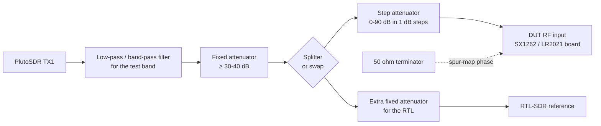

# SX1262 / LR2021 receive bench harness

Target board for this repo: **Heltec WiFi LoRa 32 V4** (SX1262), source **Pluto-compatible AD9361**, reference **RTL-SDR V4** where supported. This is the **one authoritative bench runner**; the root `tools/analyze_sweep.py` is only an offline log audit parser.

**Start with [LOCAL_QUICKSTART.md](LOCAL_QUICKSTART.md).** The Heltec V4.3 profile uses the bounded bidirectional firmware protocol and checks firmware/board/FEM identity before RF phases. Pluto TX still requires an explicit physical interlock, a configured source filter, and a verified reference check. The older `sx1262_sdr_tbd` profile remains a TODO placeholder and refuses real hardware.

This harness tests whether an SX1262 or LR2021 board really receives at a given frequency, and how well. It uses a
**PlutoSDR** as the signal source and an **RTL-SDR** as the reference receiver. It puts into practice the test plan in
section 8 of the REA deep dive (the lessons are summarised in [`TESTING-NOTES.md`](TESTING-NOTES.md)), which was written to address the gaps in
`research/sx1262-range/README.md` of SAMS0N1TE/lr2021-sdr. That study used one board, no external signal, a single
pass and no threshold for "works".

This is now the integrated SX1262-SDR bench harness. All board-specific command text lives in
`config/dut_profiles.json`; the Heltec requires its own compatible firmware, tested parser, and verified profile **before live operation**.

> Status: tested end to end **in simulation only** (see "Sample output"). Not yet run against real hardware.

## Files

| File | What it does |
| --- | --- |
| `pluto_source.py` | CW tone generator (pyadi-iio, or plain pylibiio as a fallback). Sets the LO, the DDS baseband offset, the TX attenuation (`hardwaregain`) and enable/disable. Reads the TX frequency range from the radio at runtime. Includes a TX safety interlock. `--sim` runs without hardware. |
| `rtl_reference.py` | Checks the source with the RTL-SDR (pyrtlsdr, or the `rtl_power` command as a fallback). Measures the fundamental, LO leakage, Pluto image, 2f/3f harmonics, the DUT's image frequency and a 10 dB step. An optional linearity test tells source harmonics apart from ones the dongle makes itself. |
| `dut_serial.py` | pyserial wrapper for the board's probe commands, driven by `config/dut_profiles.json`. Returns one normalised measurement for every profile. |
| `run_sweep.py` | The whole test plan. Writes CSV and JSON into `results/<run>/`. |
| `plot_results.py` | Draws `pass_fail.png` (pass fraction and SNR per rep for each frequency) and `mds.png`. |
| `sim.py` | Shared bench simulator, used by every `--sim` path. All its numbers are simulation parameters. |
| `config/default.json` | Sweep, thresholds, path losses and metadata. Copy it and edit it for each bench. |
| `config/sim_example.json` | Example values that fill in the dBm columns in simulation. **These are not measurements.** |
| `config/dut_profiles.json` | DUT command table. Each profile lists file:line evidence for its command syntax. |
| `tests/test_harness.py` | Parser, logic, safety and end-to-end simulation tests (`python -m pytest -q tests`). |
| `VERIFY.md` | Testing checklist: what a result must show before anyone trusts it. |
| `TESTING-NOTES.md` | Methodology lessons from the review of the original SX1262 range test. |
| `LICENSE` | GPL-3.0 text. The harness is GPL-3.0 (see Credits). |
| `sample_output/` | One small simulated example run (summary, metadata, chart). |

## Wiring



Text version:

```
Pluto TX1 -> LPF/BPF -> fixed atten (>=30-40 dB) -+-> step atten -> DUT RF in
                                                  |
                                                  +-> (splitter port 2, or swap the cable) -> extra atten -> RTL-SDR
Spur map phase: DUT RF in -> 50 ohm terminator, Pluto disconnected.
```

- **Filter.** Place a filter at the Pluto output so the Pluto's harmonics do not reach the DUT. The RTL check
  measures what gets through anyway.
- **Fixed attenuator.** Use 30-40 dB or more, fitted directly at the Pluto. The harness refuses to transmit unless
  `path.fixed_atten_db` (or `--fixed-atten-db`) is at least `pluto.min_fixed_atten_db` (30). It also caps
  `hardwaregain` at `pluto.max_gain_db` (-20 dB).
- **Input limits.** For the SX1262, the Semtech datasheet (DS_SX1261-2 V1.1) gives:
  - **+10 dBm** absolute maximum RF input level (Table 3-2, "Pmr").
  - **0 dBm** maximum RF input power in the operating range (Table 3-3, "ML").
  
  Worst-case DUT input = (Pluto output at 0 dB gain) + `max_gain_db` - (fixed + filter + cable losses). Measure the
  Pluto's output once with a power meter. With 40 dB of fixed attenuation and the -20 dB cap, the DUT sees the Pluto
  maximum minus 60 dB. I did not look up an LR2021 maximum input level, so check the LR2021 datasheet before relying
  on the same margin.
- **Splitter vs swap.** With `rtl.path = "splitter"`, enter `path.splitter_loss_db`. With `"swap"` (the default),
  the harness pauses and tells you when to move the cable. The source check (phase 1) always runs before the DUT
  phases.

### Safety and legal

- Never connect the Pluto TX directly to the DUT or to the RTL-SDR. Always fit the fixed attenuator first.
- This is a **cabled** bench test. Keep everything coax-connected and terminated, and put the DUT in a metal box
  where possible, so nothing radiates. Leave open SMA ports terminated. Keep TX power minimal: the harness starts
  at -40 dB `hardwaregain` and only ever steps down from there.
- The harness disables TX (lowest gain, DDS off, TX LO powered down) after every item, on exit, on Ctrl+C and when
  it opens the Pluto.

## Install

Simulation needs only `numpy` and `matplotlib`. Hardware runs also need `pyserial`, `pylibiio` (or `pyadi-iio`),
and `pyrtlsdr` or the `rtl_power` program.

```
python -m venv .venv && .venv\Scripts\activate      # optional
pip install -r requirements.txt
```

## Usage

1. **Detect the hardware.** Nothing transmits during these commands.
   ```
   python pluto_source.py --detect --uri ip:192.168.2.1
   python dut_serial.py --list
   python dut_serial.py --profile lakeshark_sx1262 --port COM39     # info, if the profile has one
   ```
   The Pluto's TX range comes from `ad9361-phy/altvoltage1/frequency_available`. Test frequencies outside it are
   skipped and logged.
2. **Edit the config.** Copy `config/default.json` to `my_bench.json` and fill in:
   - `path.*` losses, measured or from the parts' data
   - `pluto.ref_dbm_at_0db_gain`, if you have a power meter reading
   - `meta.*`: board ID, chip and ROM, firmware repo and commit
   - the DUT `profile` and `port`
   
   Unknown values stay `null`. They never get a default number.
3. **Run.**
   ```
   # FUTURE ONLY, when verified Heltec RX firmware/profile, revision,
   # FEM, filter, measured path attenuation and controlled cabling exist:
   python run_sweep.py --config my_bench.json --profile VERIFIED_HELTEC_RX_PROFILE --port COMXX --arm-rf
   ```
   It refuses TX without a verified profile, board revision/FEM, actual source filter, declared fixed attenuation >=30 dB, `--arm-rf` and an exact operator-typed phrase. `--yes` is **simulation-only**. It asks for firmware commit and temperatures, then prompts for cabling at each stage.
4. **Read the results.** Open `results/<run>/summary.csv` and `pass_fail.png`. `measurements.csv` has every rep,
   `meta.json` has configuration and sweep order, and `run.log` has the raw console traffic. An append-only `SX1262-SDR.log` is also created in the **directory from which the program was run**.

### Simulation demo

```
python run_sweep.py --sim --config config/sim_example.json
python run_sweep.py --sim --profile lakeshark_lr2021 --imd --sim-pluto-range 70e6:6e9 --freqs 80,150,433.92,868,1500,2450,2700,3500
python -m pytest -q tests
```

The simulator deliberately includes three faults:
- a board spur sitting on the 433.92 MHz test tone
- a Pluto image that is too strong near 1300 MHz
- SX1262 lock gaps shaped like those in the research README (no lock at 1448-2622 MHz and above 3494 MHz)

Each fault shows up as a FAIL with the reason that caught it.

## The test plan, and what each number means

Each test frequency F runs `reps` times (at least 5). The order of all (frequency, rep) pairs is randomised from a
recorded seed, so slow drift such as temperature or a loosening cable spreads across frequencies instead of hiding
in one.

| Step | What happens | Plain meaning |
| --- | --- | --- |
| Source check (RTL) | The tone at F+delta is measured on the RTL-SDR, along with the LO leak, Pluto image, 2f, 3f and the DUT's image frequency (F-delta), plus a 10 dB step | Is the signal generator itself clean, and does "10 dB less" really mean 10 dB less? A dirty source can make a deaf receiver look alive. |
| Spur map | DUT input terminated, Pluto off, at F and F+retune | What does the board hear when nothing is connected? Its own clocks show up here. If one sits where the test tone will land, that frequency is marked `spur_conflict`. |
| Base | Tone at F+delta, DUT tuned to F | **SNR**: how far the tone stands above the noise. **Noise floor**: the background level. **ppm**: how far the DUT's frequency is from the Pluto's. **Image rejection**: how much weaker the mirror copy at F-delta is. |
| Check 1: source shift | Tone moved +shift | A real reception moves the same way and keeps its level. A spur from the board does not move. |
| Check 2: retune **(IQ profiles only)** | DUT tuned to F+retune | A simultaneous IQ receiver should report the expected opposite baseband-offset movement. Not independent for a serial SX1262 absolute-frequency RSSI scan and thus excluded there. |
| Check 3: attenuation | Tone 10 dB lower | The response should drop by the measured source step (nominally 10 dB), without AGC obscuring it. |
| Check 4: source OFF **(all profiles)** | Pluto DDS and LO disabled; repeat the same DUT reception test | A source-related response must disappear or fall below threshold. Existing board spurs should remain and invalidate a false hit. |
| Check 5: reference clean | Independent RTL observation where physically possible | If the reference cannot cover the frequency, the source is **UNVERIFIED**, not clean. |
| MDS | Source stepped down until SNR drops below threshold | The weakest signal the board still detects (in dBm once the Pluto output and losses are known, otherwise as Pluto gain). |
| IMD (optional, I/Q profiles) | Two tones; look for third-order products | How badly two strong signals mix into false ones. Shown as a lower bound when the products stay under the reported peaks. |

**Pass rule (in `config/default.json`, field `pass`).** An item passes if:
- SNR is at least `snr_min_db` (10 dB),
- all checks applicable to that receiver architecture pass, including the source-OFF control, and
- there is no spur conflict.

For SX1262 RSSI sweeps, the required checks are source-shift, attenuation, source-OFF, and reference purity. The retune-offset test is expressly **not** credited as independent evidence. A frequency passes if at least `freq_pass_fraction` (0.8) of its reps pass. A frequency is reported as
**UNVERIFIED**, not PASS, when the RTL could not see the source, for example above the dongle's range (set
`rtl.range_hz`).

### Profile notes (from the source)

- **`lakeshark_sx1262`: `lora sxprobe`.** This is an RSSI sweep. LS:`ls_lora_sx126x.c:1105-1143` parses the
  arguments and `:1230-1251` prints the output.
  - The harness sweeps around F+delta. The "offset" is the step with the highest RSSI, and the noise is the median
    step.
  - RSSI comes in 0.5 dB steps and floors at -127.5 dBm (`research/sx1262-range/README.md:216-217`), so very low
    SNRs read short.
  - Image rejection is N/A because the SX1262 IF is not documented here. PLL errors on **any** scanned step or an incomplete SXPROBE response reject the entire measurement, including failed steps without RSSI.
  - The sweep visits absolute RF points: moving the displayed nominal centre does not prove a changed receiver IF or LO. The paired Pluto source-OFF control is mandatory.
- **`lakeshark_lr2021`: `lora lrprobe`.** LS:`ls_lora_lr20xx.c:4177-4199` parses the arguments, `:4238-4244` and
  `:4154-4174` print the output.
  - The board itself reports only the 3 strongest peaks of a 1024-bin spectrum, as dB over the median bin.
  - Use a **fixed gain** (0-13). Gain 14 is host AGC (`:4186`) and would hide the 10 dB step.
  - Tuning is in whole kHz. The harness corrects the expected offset for this.
- **`lr2021_sdr_standalone`: `tune` / `capture` / `dump` / `info`.** The commands are in SDR:`main.c:44-102` and
  `info` is in `radio.c:225-233`.
  - The hex dump is checked against its CRC and analysed on the host in the same way as `lrprobe`.
  - `tune` accepts only 150-960 MHz (`main.c:94`), and the rate is fixed at 125 kHz.
  - The chip's own AGC is left on, so check 3 can fail for that reason alone.
- **`sx1262_sdr_tbd`.** A placeholder for the new repo. It is a copy of the sxprobe profile until that firmware's
  console is known.

## Sample output (simulation; historical pre-consolidation run)

The checked-in sample was produced by the original Grok harness **before** the consolidated source-OFF and RSSI verdict fixes. Do not treat its per-frequency verdicts as current regression expectations. Generate fresh output with `python run_sweep.py --sim --config config/sim_example.json`.

`sample_output/20261016-134931_heltec-v4-sim_SIM/` is a small example from `python run_sweep.py --sim --config config/sim_example.json --label heltec-v4-sim`: `summary.csv`, `meta.json` and `pass_fail.png`. It used 5 reps, seed 20261016, Python 3.14.3 on Windows, and the simulated stock Pluto range, so 169.4 and 315 MHz were skipped.

```
MHz        verdict     pass  SNRavg   SNRsd      IRR      ppm  MDSgain  reasons
433.920    FAIL        0/5     32.4    0.12     None    -2.31    -89.0  spur_conflict x5
600.000    PASS        5/5    32.26    0.43     None    -3.33    -64.0
868.000    PASS        5/5    36.58    0.11     None    -3.46    -66.0
915.000    PASS        5/5     36.7    0.19     None    -3.28    -67.0
1000.000   PASS        5/5    34.76    0.21     None     -3.0    -66.0
1300.000   FAIL        0/5    32.78    0.08     None    -3.08    -63.0  rtl_clean x5
1447.000   PASS        5/5    31.32    0.18     None    -2.76    -61.0
2450.000   FAIL        0/5     0.44    0.21     None    -0.82     None  no_lock x5;snr_below_10 x5;atten_10db x5;source_shift x3;retune x2
2700.000   UNVERIFIED  5/5    21.88    0.11     None    -3.33    -52.0  rtl_unverified x5
3000.000   UNVERIFIED  5/5    21.62    0.25     None    -3.33    -52.0  rtl_unverified x5
```

Every number above comes from `sim.py`, not from a radio. The simulator deliberately includes three faults, and each one is caught:
- **433.92 MHz:** a board spur on the test tone.
- **1300 MHz:** the Pluto's image is only 20 dB down, so the source is not trusted.
- **2450 MHz:** SX1262 lock gap.

The UNVERIFIED rows are above the RTL's range, so the source could not be checked there.

## Bench check on NewcorePC (2026-10-16, read-only, nothing transmitted)

- **Pluto.** `iio_info -s` found `FISH Ball PlutoSDR Rev.A (Z7020/AD9361)`, fw v2.3, at `ip:192.168.2.1` (USB) and `192.168.1.228` (LAN).
  - `frequency_available` reports TX LO 46.875 MHz-6 GHz and RX LO 70 MHz-6 GHz. This is an AD9361 part, so no AD9364 hack is needed for that range.
  - At query time, TX `hardwaregain` was -89.75 dB with the TX LO powered up.
- **libiio.** `iio_info` and `iio_attr` are in System32. `pylibiio` imports and reports 0.26, while pip metadata says 0.25.
- **pyadi-iio.** Not installed. The harness falls back to pylibiio.
- **RTL-SDR.** `pyrtlsdr` 0.5.0 is installed but fails on import with `function 'rtlsdr_set_dithering' not found`, because the librtlsdr DLL on the PATH is older than this pyrtlsdr expects. `rtl_power`, `rtl_test` and `rtl_sdr` are in System32, and the harness falls back to `rtl_power`. `rtl_test -t` found no dongle plugged in.
- **Serial.** ESP32 USB-JTAG serial devices are on COM17 and COM39, and a CH343 adapter is on COM40. None were opened, so pick the DUT port yourself.
- **Python.** pyserial 3.5, numpy 1.26.4, matplotlib 3.11.2 and pytest 9.0.2 are all present. No venv was needed.

## Heltec WiFi LoRa 32 V4 notes (third-party sources, verify on your board)

According to third-party sources (not verified on Erik's board), the V4 puts an external front-end module (FEM) between the antenna and the SX1262:
- **V4.2:** GC1109, according to Meshtastic `variants/esp32s3/heltec_v4/variant.h` @ ec5d2303.
- **V4.3:** KCT8103L, according to Heltec's `docs/devices/open-source-hardware/lna.md` in HelTecAutomation/HeltecNewDocs.
- In receive, the FEM is either in **LNA mode** (CSD=1, CTX=0) or in **bypass mode** (CSD=1, CTX=1, CPS=0), depending on the firmware.

That matters for testing:
- Record `meta.board_revision`, `meta.fem_part` and `meta.fem_mode` for every run, and test both FEM modes.
- **The safe input level is the FEM's, not the SX1262's.** The SX1262 datasheet limits above apply at the chip pins. The FEM's limits weren't checked here, so keep the 30-40 dB fixed attenuator.
- **Out-of-band results describe the FEM and its matching as much as the SX1262.** The tuning windows published in lr2021-sdr's `research/sx1262-range/README.md` were measured on a different board, without this FEM, so they do not carry over.

## Credits and license

- **Upstream projects.** The console formats, probe commands and test-plan motivation come from **SAMS0N1TE**'s GPL-3.0 projects: [lr2021-sdr](https://github.com/SAMS0N1TE/lr2021-sdr) (commit 9706241b, including `research/sx1262-range` and `research/rx-range-and-gain`) and [LakeShark](https://github.com/SAMS0N1TE/LakeShark) (commit 8586c6de). `analyze_iq16le()` re-implements LakeShark's `probe_report()` algorithm in Python.
- **License.** The harness is released under the GPL-3.0 (`LICENSE`); every Python file carries an SPDX header.
- **Authorship.** Written by REA Bot for Erik Elfstrom, 2026-10-16.
